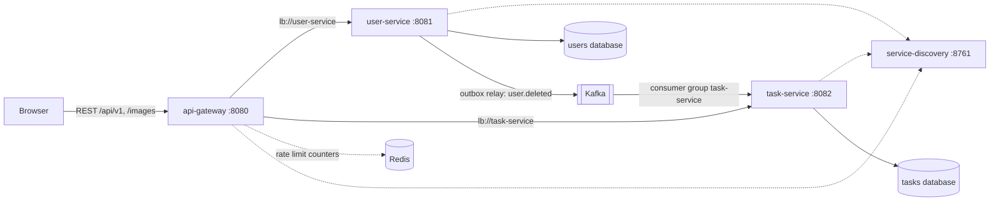

# Taskly Backend (Spring Boot Microservices)

A task manager backend: sign up and sign in, manage your profile and avatar, and create, filter, sort and paginate to-do tasks. It started as a modular monolith and is now split into independently deployable microservices behind an API gateway. The HTTP contract is unchanged, so the existing Taskly frontend keeps working against `http://localhost:8080` without modification.

**Stack:** Java 25 · Spring Boot 4.1 · Spring Framework 7 · Spring Cloud 2025.1 (Gateway, Eureka, Resilience4j) · Apache Kafka · Redis · PostgreSQL 18 · Flyway · JWT · OpenTelemetry · Docker · GitHub Actions

## Contents

- [Quick start](#quick-start)
- [Architecture](#architecture)
- [Domain analysis](#domain-analysis)
- [Communication design](#communication-design)
- [Data strategy](#data-strategy)
- [Resilience](#resilience)
- [Observability](#observability)
- [Security](#security)
- [API contract](#api-contract)
- [Configuration](#configuration)
- [Testing](#testing)
- [CI](#ci)
- [Migrating data from the monolith](#migrating-data-from-the-monolith)
- [Limits](#limits)

## Quick start

Requires JDK 25 and Docker.

### Everything in Docker

```sh
cd taskly-docker
make docker/up
make docker/seed
make docker/smoke
```

`make docker/up` creates `taskly-docker/.env` with random database passwords and `AUTH_SECRET` on the first run, builds the five images and waits until every container is healthy. The gateway listens on `http://localhost:8080` and the Eureka dashboard on `http://localhost:8761`. `make docker/seed` creates the demo users through the public API (login `johndoe123@mail.com` / `password123`). `make docker/smoke` runs an end-to-end check: sign up, create a task, delete the user, and wait until the `user.deleted` event has removed the tasks in the other service.

`make docker/up-obs` additionally starts Grafana with Tempo, Loki and Prometheus (`http://localhost:3000`) plus Alloy, which ships container logs to Loki, and turns tracing on.

### Services on the host, infrastructure in Docker

```sh
cd taskly-docker
make docker/dev-up
openssl rand -base64 32
```

Copy `.env.example` to `.env` in each service folder and paste the generated value into `AUTH_SECRET` of both `taskly-backend-user-service` and `taskly-backend-task-service`. The two values must be identical. Then start the services in this order, each in its own terminal:

```sh
cd taskly-backend-service-discovery && ./mvnw spring-boot:run
cd taskly-backend-user-service && ./mvnw spring-boot:run
cd taskly-backend-task-service && ./mvnw spring-boot:run
cd taskly-backend-api-gateway && ./mvnw spring-boot:run
```

| Component         | URL / port                                                                                     |
| ----------------- | ---------------------------------------------------------------------------------------------- |
| API gateway       | http://localhost:8080                                                                          |
| User service      | 8081 (registered in Eureka, not published by Docker)                                           |
| Task service      | 8082 (registered in Eureka, not published by Docker)                                           |
| Eureka dashboard  | http://localhost:8761                                                                          |
| Grafana (dev)     | http://localhost:3000                                                                          |
| pgAdmin (dev)     | http://localhost:5050, login `admin@taskly.dev` / `admin`                                      |
| PostgreSQL (dev)  | `localhost:5432` user database `taskly_users`, `localhost:5433` task database `taskly_tasks`   |
| Kafka (dev)       | `localhost:9094`                                                                               |
| Redis (dev)       | `localhost:6379`                                                                               |

| Goal                  | Command (from `taskly-docker`)             |
| --------------------- | ------------------------------------------ |
| Start the full stack  | `make docker/up`                           |
| Start with telemetry  | `make docker/up-obs`                       |
| Follow service logs   | `make docker/logs`                         |
| Seed demo data        | `make docker/seed`                         |
| End-to-end smoke test | `make docker/smoke`                        |
| Stop everything       | `make docker/down`                         |
| Remove volumes/images | `make docker/clean`                        |

## Architecture



| Service             | Port | Responsibility                                                                 | Owned data                                |
| ------------------- | ---- | ------------------------------------------------------------------------------ | ----------------------------------------- |
| `api-gateway`       | 8080 | Single entry point: routing, CORS, correlation ID, timeouts, retries, circuit breaker, rate limiting, uniform JSON errors | Rate-limit counters in Redis (ephemeral)  |
| `service-discovery` | 8761 | Eureka registry used for `lb://` routing                                       | In-memory registry                        |
| `user-service`      | 8081 | Sign up, sign in, sign out, profile, avatar, account deletion, token issuing   | `users`, `outbox_events`, avatar files    |
| `task-service`      | 8082 | Task CRUD, filtering, sorting, pagination, reaction to deleted accounts        | `tasks`, `deleted_users`                  |

Each service is a Spring Boot application with its own `pom.xml`, `Dockerfile`, configuration and tests. There is no shared library: the few small types two services have in common (the event envelope and the JWT verification) are deliberately duplicated so that either service can be built, versioned and deployed on its own.

## Domain analysis

The monolith already had two modules that never imported each other. Domain-Driven Design confirms them as two bounded contexts:

| Bounded context   | Ubiquitous language                              | Aggregate | Reason it is separate                                                                                   |
| ----------------- | ------------------------------------------------ | --------- | ------------------------------------------------------------------------------------------------------- |
| Identity & Users  | user, credentials, token, avatar, account         | `User`    | Own invariants (unique email and username, password rules), security-sensitive data, file storage       |
| Task Management   | task, priority, due date, status, owner           | `Task`    | Different change rate and load profile, references the user only by identifier                           |

Context map: Users is the upstream context and publishes the integration event `user.deleted`. Tasks is the downstream context and conforms to that published language. Tasks never calls Users and keeps no copy of user data apart from the opaque `owner_id` and a tombstone for deleted users.

Validation of each candidate service:

| Check                                | `user-service`                                          | `task-service`                                                  |
| ------------------------------------ | ------------------------------------------------------- | --------------------------------------------------------------- |
| Owns its data exclusively            | Own PostgreSQL database and credentials, own avatar volume | Own PostgreSQL database and credentials, no foreign key to users |
| Clear public API contract            | `/api/v1/auth/**`, `/api/v1/users/**`, `/images/**`     | `/api/v1/tasks/**`                                              |
| Deployable independently             | Own image, health check, migrations and configuration   | Own image, health check, migrations and configuration           |

The split stops at two business services on purpose. Authentication and profile management share one aggregate and one table (`email`, `username`, `password_hash`), so splitting them would only add data synchronisation. Avatar handling is a few hundred lines tightly bound to the user aggregate.

## Communication design

| Interaction                              | Style        | Protocol           | Why                                                                                          |
| ---------------------------------------- | ------------ | ------------------ | -------------------------------------------------------------------------------------------- |
| Browser to gateway                       | Synchronous  | REST/JSON          | Unchanged frontend contract                                                                  |
| Gateway to user-service / task-service   | Synchronous  | REST/JSON via Eureka | Request/response commands and queries answered in well under 100 ms                         |
| Account deleted, tasks must be removed   | Asynchronous | Kafka event        | Cross-aggregate operation across two databases, must not block or fail the deletion         |
| Service to service queries               | None         | -                  | JWT carries the user id and tasks reference users by id only, so no synchronous call is needed |

There is no synchronous call between business services, so no gRPC is introduced: it would add a schema toolchain without removing a single hop.

### Event contract

Topic `taskly.user.events` (3 partitions), key is the user id, so all events of one user are ordered. Headers: `event-id`, `event-name`, `X-Correlation-Id`. Dead letters go to `taskly.user.events.DLT`.

```json
{
  "eventId": "6f1c0f0e-8c0e-4c43-9e2b-2f6f3b3f5a10",
  "name": "user.deleted",
  "occurredAt": "2026-11-07T08:15:30.123Z",
  "correlationId": "b1c2d3e4-1111-2222-3333-444455556666",
  "payload": { "userId": "0b9c4f2e-6a0b-4d0e-9d57-0b6f2a8f7a11" }
}
```

Consumers ignore unknown fields and unknown event names, so the contract can grow without coordinated releases.

## Data strategy

- **Database per service.** `taskly-user-db` and `taskly-task-db` are separate PostgreSQL instances with separate credentials. The `tasks.owner_id` foreign key of the monolith is gone. There is no shared schema.
- **Eventual consistency aligned with contexts.** Strong consistency exists inside each service (one local transaction). Across services the system is eventually consistent through `user.deleted`.
- **Transactional outbox in user-service.** Deleting a user and inserting the event into `outbox_events` happen in one database transaction, so an event is never lost and never published for a rolled-back deletion. A relay polls with `FOR UPDATE SKIP LOCKED` (safe with several instances), publishes with `acks=all` and idempotence, marks the row as published and retries failures with exponential backoff capped at 60 seconds. Published rows are removed after 24 hours.
- **Idempotent consumer with a tombstone in task-service.** Handling `user.deleted` records the user in `deleted_users` and deletes their tasks in one transaction, and redelivery is harmless. Because the foreign key no longer protects against late writes, `POST /tasks/create` rejects tokens of deleted users with `401 Unauthorized: User account no longer exists`. Tombstones are purged after 48 hours, longer than the one hour token lifetime.
- **Event sourcing is not used.** The domain has no audit or replay requirement, so plain state storage plus an outbox is the simpler and safer choice.

## Resilience

Every external call has an explicit timeout, a bounded retry budget and a degradation path.

| Call                                  | Timeout                                    | Retry budget                                          | Degradation                                                                  |
| ------------------------------------- | ------------------------------------------ | ----------------------------------------------------- | ---------------------------------------------------------------------------- |
| Gateway to services                   | connect 1 s, response 4 s, upload 15 s     | 2 retries, `GET` only, 502/503/504, backoff 100-500 ms | Circuit breaker per service (50% of 20 calls, 10 s open) and a JSON `503` fallback with `Retry-After` |
| Gateway connection pool               | acquire timeout 2 s, 200 connections       | -                                                     | Bulkhead: a slow service cannot exhaust the gateway                          |
| Gateway to Redis                      | 500 ms                                     | -                                                     | Fail-open: if Redis is down the rate limiter allows the request             |
| Brute-force protection                | -                                          | -                                                     | `signin` and `signup` limited per client address (5 req/s, burst 10), then `429` |
| Services to Eureka                    | connect 2 s, read 4 s                      | Heartbeat every 10 s                                  | Cached registry keeps routing if Eureka is briefly unavailable              |
| Services to PostgreSQL                | pool 5 s, validation 3 s, socket 15 s, query 5 s | -                                              | Data-access failures map to `503` with `Retry-After` instead of `500`       |
| user-service to Kafka                 | send 8 s, delivery 10 s, block 5 s         | Outbox retries with exponential backoff, no limit     | Account deletion still succeeds while Kafka is down, the event is delivered later |
| task-service Kafka consumer           | request 10 s                               | 5 retries, 500 ms doubling up to 10 s                 | Then the record goes to the `.DLT` topic, malformed events skip retries      |
| Avatar upload                         | gateway 15 s                               | none (`POST`)                                         | Spring Framework 7 `@ConcurrencyLimit` bulkhead (8 concurrent uploads)       |

## Observability

- **Correlation ID.** The gateway accepts a valid `X-Correlation-Id` (8 to 100 characters of `A-Z a-z 0-9 . _ -`) or generates one, forwards it to the services and returns it in every response, including errors, preflight and `503` fallbacks. Each service puts it in the logging MDC. The outbox row and the Kafka headers carry it too, so the consumer in task-service logs the same ID.
- **Distributed tracing.** Micrometer Tracing with OpenTelemetry exports spans over OTLP (`OTLP_TRACES_ENDPOINT`). HTTP calls, database calls and Kafka send/receive are instrumented. Sampling is controlled by `TRACING_SAMPLING_PROBABILITY`.
- **Centralised logging.** In Docker every service writes ECS JSON to stdout (`LOGGING_STRUCTURED_FORMAT_CONSOLE=ecs`), including `correlationId`, `traceId` and `spanId`. With `make docker/up-obs`, Alloy ships all container logs to Loki.

Tracing one request across every service with Grafana (Explore, Loki):

```
{service=~"taskly-.*"} | json | correlationId="smoke-1700000000-0001"
```

The `make docker/smoke` target performs this check automatically and fails if the correlation ID of a deletion is missing from the gateway, user-service or task-service logs.

## Security

- The JWT (HS256, claim `id`, one hour) is still issued by `user-service` and stored in the HTTP-only `taskly_token` cookie. The gateway forwards the cookie untouched, and both `user-service` and `task-service` verify the token themselves, so no service trusts the network.
- `AUTH_SECRET` must be the same in `user-service` and `task-service`. For larger deployments replace the shared secret with an asymmetric key pair, where only `user-service` holds the private key.
- Only the gateway publishes a port. The services, databases, Kafka and Redis stay on the internal Docker network.
- CORS is handled once, in the gateway. The services send no CORS headers.

## API contract

Paths, methods, request and response bodies, status codes, messages and cookies are those of the monolith:

| Route                                                               | Served by      |
| ------------------------------------------------------------------- | -------------- |
| `GET /`, `GET /actuator/health`                                     | gateway        |
| `POST /api/v1/auth/signup`, `POST /api/v1/auth/signin`, `GET /api/v1/auth/signout` | user-service |
| `GET /api/v1/users`, `GET /api/v1/users/{id}`, `PATCH /api/v1/users/update/{id}`, `POST /api/v1/users/upload/{id}`, `DELETE /api/v1/users/delete/{id}` | user-service |
| `GET /images/**` (avatars)                                          | user-service   |
| `GET /api/v1/tasks/user/{id}`, `GET /api/v1/tasks/{id}`, `POST /api/v1/tasks/create`, `PATCH /api/v1/tasks/{id}`, `DELETE /api/v1/tasks/{id}` | task-service |

Differences, all limited to failure modes the monolith did not have:

| Situation                                              | Response                                                                 |
| ------------------------------------------------------ | ------------------------------------------------------------------------ |
| A service or its database is unreachable               | `503` with `{"status":503,"message":"Service temporarily unavailable. Please try again later."}` and `Retry-After` |
| A service is too slow                                  | `504` with a JSON `status` and `message`                                 |
| Too many `signin` or `signup` requests from one address | `429` with `X-RateLimit-*` headers and an empty body                    |
| Creating a task with the token of a deleted account    | `401` with `Unauthorized: User account no longer exists`                 |
| Every response                                         | Adds the `X-Correlation-Id` header                                       |

## Configuration

Values in `.env` are read from the working directory of each service and can also be provided as regular environment variables.

### user-service

| Variable                | Default                  | Purpose                                                      |
| ----------------------- | ------------------------ | ------------------------------------------------------------ |
| `APP_PORT`              | `8081`                   | Port                                                         |
| `APP_LEVEL`             | `development`            | `production` hardens the cookie                              |
| `DATABASE_URL`          | required                 | JDBC URL of the users database                               |
| `DATABASE_USER`         | required                 | Database user                                                |
| `DATABASE_PASSWORD`     | required                 | Database password                                            |
| `AUTH_SECRET`           | required                 | JWT secret, at least 32 characters, shared with task-service |
| `COOKIE_DOMAIN`         | empty                    | Domain of the auth cookie in production                      |
| `BCRYPT_ROUNDS`         | `10`                     | bcrypt cost factor                                           |
| `PUBLIC_DIR`            | `public`                 | Directory served as static files, holds the avatars          |
| `AVATAR_UPLOAD_CONCURRENCY` | `8`                  | Maximum concurrent avatar uploads                            |
| `KAFKA_BOOTSTRAP_SERVERS` | `localhost:9094`       | Kafka brokers                                                |
| `USER_EVENTS_TOPIC`     | `taskly.user.events`     | Topic of the user events                                     |
| `OUTBOX_RELAY_ENABLED`  | `true`                   | Turns the outbox relay on or off                             |
| `EUREKA_URL`            | `http://localhost:8761/eureka` | Registry address                                       |

### task-service

| Variable                | Default                  | Purpose                                                      |
| ----------------------- | ------------------------ | ------------------------------------------------------------ |
| `APP_PORT`              | `8082`                   | Port                                                         |
| `DATABASE_URL`          | required                 | JDBC URL of the tasks database                               |
| `DATABASE_USER`         | required                 | Database user                                                |
| `DATABASE_PASSWORD`     | required                 | Database password                                            |
| `AUTH_SECRET`           | required                 | Same value as in user-service                                |
| `KAFKA_BOOTSTRAP_SERVERS` | `localhost:9094`       | Kafka brokers                                                |
| `KAFKA_CONSUMER_GROUP`  | `task-service`           | Consumer group                                               |
| `KAFKA_LISTENER_CONCURRENCY` | `3`                 | Consumer threads, at most the number of partitions           |
| `EUREKA_URL`            | `http://localhost:8761/eureka` | Registry address                                       |

### api-gateway

| Variable                    | Default                  | Purpose                                                  |
| --------------------------- | ------------------------ | -------------------------------------------------------- |
| `APP_PORT`                  | `8080`                   | Port                                                     |
| `CLIENT_URL`                | `http://localhost:3000`  | Allowed CORS origin                                      |
| `REDIS_HOST`, `REDIS_PORT`, `REDIS_PASSWORD` | `localhost`, `6379`, empty | Redis used by the rate limiter          |
| `AUTH_RATE_LIMIT_REPLENISH`, `AUTH_RATE_LIMIT_BURST` | `5`, `10` | Tokens per second and burst for `signin` and `signup` |
| `FORWARD_HEADERS_STRATEGY`  | `none`                   | Set to `framework` behind a load balancer so the real client address is used as the rate-limit key |
| `EUREKA_URL`                | `http://localhost:8761/eureka` | Registry address                                   |

### Shared by every service

| Variable                  | Default                          | Purpose                                              |
| ------------------------- | -------------------------------- | ---------------------------------------------------- |
| `TRACING_ENABLED`         | `true`                           | Turns tracing on or off                              |
| `TRACING_SAMPLING_PROBABILITY` | `1.0`                       | Share of traces that are sampled                     |
| `OTLP_TRACES_ENDPOINT`    | `http://localhost:4318/v1/traces` | OTLP/HTTP trace endpoint                            |
| `LOG_LEVEL`               | `debug`                          | Log level of the `com.taskly` packages               |
| `LOG_FILE`                | `logs/<service>.log`             | Log file, set it empty to log to the console only    |

Docker only, in `taskly-docker/.env`: `PORT`, `USER_DB_NAME`, `USER_DB_USER`, `USER_DB_PASSWORD`, `TASK_DB_NAME`, `TASK_DB_USER`, `TASK_DB_PASSWORD`, `AUTH_SECRET`, `APP_LEVEL`, `CLIENT_URL`, `COOKIE_DOMAIN`, `LOG_LEVEL`. Run `make docker/env` to generate the secrets.

## Testing

Run from each service folder. The integration tests of `user-service` and `task-service` need PostgreSQL and create a throwaway database per run, through `TEST_DATABASE_URL` (default points at the development containers).

```sh
./mvnw test
./mvnw verify
```

| Service             | Unit tests                                                                          | Integration tests                                                                                     |
| ------------------- | ----------------------------------------------------------------------------------- | ----------------------------------------------------------------------------------------------------- |
| `user-service`      | Domain, use cases, outbox relay and backoff, event envelope, JWT, bcrypt, avatar storage | Auth and users API, transactional outbox, correlation ID, rejected deletion leaves no event          |
| `task-service`      | Domain, use cases, tombstone, event envelope, JWT verification                       | Task API, handling `user.deleted` (delete, tombstone, idempotency, malformed events), correlation ID  |
| `api-gateway`       | Correlation ID, error mapping, fallback, rate-limit key                              | Route table and per-route timeouts                                                                    |
| `service-discovery` | -                                                                                   | Registry and health endpoints                                                                          |

`make docker/smoke` covers the whole system, including Kafka, the outbox and the correlation ID across services.

## CI

GitHub Actions builds and tests every service in a matrix, then starts the Docker stack, checks that both services registered in Eureka, runs the seed and the end-to-end smoke test.

## Migrating data from the monolith

Start the new stack once so Flyway creates the schemas, then copy the rows. Table names and columns are unchanged.

```sh
pg_dump --data-only --table=users "$OLD_DATABASE_URL" | psql "$NEW_USERS_DATABASE_URL"
pg_dump --data-only --table=tasks "$OLD_DATABASE_URL" | psql "$NEW_TASKS_DATABASE_URL"
```

Copy the avatar files of the old `public/images/users` directory into the `taskly-avatars` volume. Users keep their passwords because the hashing is unchanged, and existing sessions stay valid if `AUTH_SECRET` is kept.

## Limits

- Avatars are stored on a local volume, so run a single `user-service` instance or move them to object storage before scaling it out.
- Kafka, Redis and Eureka run as single nodes in the provided Docker setup. Use clusters in production.
- The rate limiter keys clients by address, so users behind one shared address share a budget.
- Between the deletion of a user and the processing of the event, a still-valid token can create a task. The event handler removes it, and later requests are rejected by the tombstone. A write that races the handler within the same few milliseconds could leave one orphan task.
- The default `.env` values target local development only.
